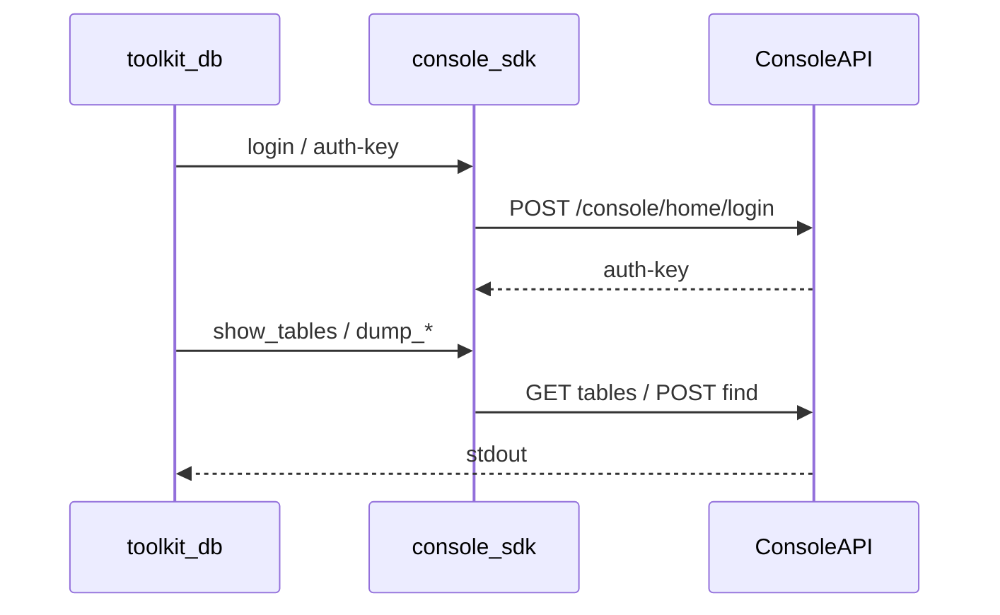

# Backendless Console SDK + `backendless-toolkit-db`

## Контекст

Беремо **Console API**, як у [Backendless Console SDK](https://github.com/Backendless/Console-SDK) (`backendless-console-sdk@3`).

Важливо: Console API офіційно «внутрішній» і може змінюватися без notice — фіксуємо це в коментарі модуля; ендпоінти копіюємо з SDK.



## Ендпоінти (з Console SDK)

| Операція | Method / path | Auth |
|----------|---------------|------|
| Developer login | `POST /console/home/login` body `{login, password}` | —; `auth-key` у response header |
| List tables (+ schema) | `GET /{appId}/console/data/tables` | header `auth-key` |
| Load records | `POST /{appId}/console/data/{tableName}/find` body `{pageSize, offset, ...}` | header `auth-key` |

Відповідь `list tables` уже містить `columns` / relations — цього достатньо для `dump_table_structure` без окремого endpoint.

Base URL конфігурується (напр. `https://eu-develop.backendless.com` або self-hosted).

---

## 1. Крейт `backendless_console_sdk/`

```
backendless_console_sdk/
  Cargo.toml
  src/
    lib.rs
    error.rs
    client.rs     // ConsoleClient: base_url, auth_key, reqwest
    auth.rs       // login
    tables.rs     // list_tables, get_table, find_records, find_all_records
```

- `list_tables(app_id) -> Vec<TableInfo>` (`name`, `tableId`, `columns`, …)
- `get_table(app_id, name) -> TableInfo` (з list або помилка «не знайдено»)
- `find_records` / `find_all_records` — paging, `page_size=100`
- HTTP: **reqwest** (json, rustls); помилки `{message,code}` → typed error
- Auth лише через `login` + `password` (без передачі готового `auth-key`); якщо login повертає `otpCreated` — явна помилка (2FA поза scope)

Залежності: `reqwest`, `serde`/`serde_json`, `thiserror`, `url`.

Workspace: [`Cargo.toml`](Cargo.toml) `members` + `workspace.dependencies`.

---

## 2. Бінарник `backendless-toolkit-db`

Додати в [`backendless_toolkit_bin/Cargo.toml`](backendless_toolkit_bin/Cargo.toml):

```toml
[[bin]]
name = "backendless-toolkit-db"
path = "src/db.rs"
```

Залежності bin: `backendless_console_sdk`, `serde_yaml`, `csv`, `tokio`, `env_logger` / `log` (як у інших entrypoints).

### Конфіг (env)

| Змінна | Призначення |
|--------|-------------|
| `BACKENDLESS_TOOLKIT__CONSOLE__URL` | Base URL console (обов’язково) |
| `BACKENDLESS_TOOLKIT__CONSOLE__APP_ID` | Application ID |
| `BACKENDLESS_TOOLKIT__CONSOLE__LOGIN` | Developer login |
| `BACKENDLESS_TOOLKIT__CONSOLE__PASSWORD` | Developer password |

На старті бінарника обов’язково завантажити [`.env`](.env) через `**dotenvy::dotenv().expect(...)**` (патерн уже є закоментованим у [`daemon.rs`](backendless_toolkit_bin/src/daemon.rs)), потім читати `CONSOLE__*` з оточення. Без `.env` або без потрібних ключів — stderr + non-zero exit.

Далі завжди `login(LOGIN, PASSWORD)` → зберегти отриманий `auth-key` у клієнті. Без `AUTH_KEY` у конфігу.

Оновити [`.env-example`](.env-example) ключами `CONSOLE__*`. Додати `dotenvy` у [`backendless_toolkit_bin/Cargo.toml`](backendless_toolkit_bin/Cargo.toml).

### Команди (argv, без clap)

```
./target/debug/backendless-toolkit-db show_tables
./target/debug/backendless-toolkit-db dump_table_structure MyTable
./target/debug/backendless-toolkit-db dump_table_data MyTable
```

| Команда | stdout | Поведінка |
|---------|--------|-----------|
| `show_tables` | імена таблиць, по одному на рядок | `list_tables` → друк `name` |
| `dump_table_structure <table>` | YAML схеми | `get_table` → serialize columns/relations через `serde_yaml` |
| `dump_table_data <table>` | CSV рядків | `find_all_records` → header з ключів (стабільний порядок: `objectId`, `created`, `updated`, решта alphabetical) + рядки через crate `csv` |

Помилки / usage → **stderr**, exit code ≠ 0. Успіх → лише потрібні дані в **stdout** (щоб можна було pipe).

Логіка CLI тонкий шар над SDK у `backendless_toolkit_bin/src/db.rs` (+ за потреби маленький `db/` модуль для CSV/YAML formatters).

---

## Поза scope

- Дамп усіх таблиць у файли одним викликом
- MCP tools для цих команд
- Console create/delete table, apps CRUD
- OTP / 2FA login