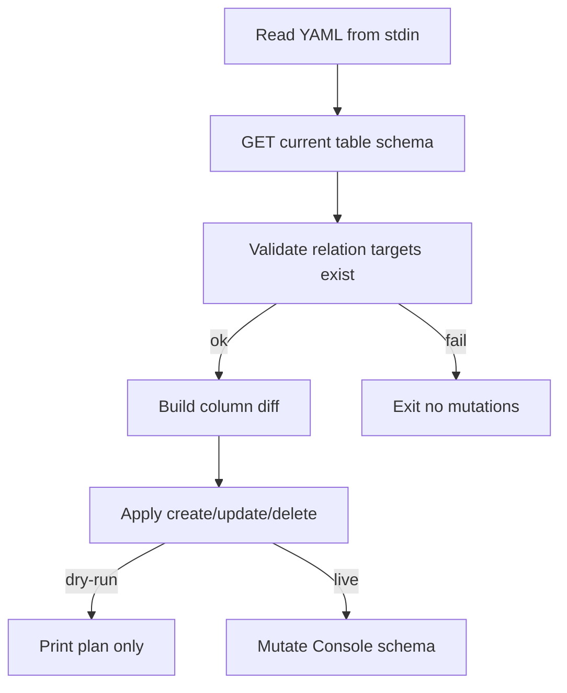

# `restore_table_structure`

## CLI

```text
cat MyTable.yaml | backendless-toolkit-db restore_table_structure MyTable \
  [--apply-required-flag] [--delete-obsolete-columns] [--dry-run]
```

| Режим | Поведінка |
| ----- | --------- |
| default | Diff → створити відсутні колонки (примусово `required: false`); оновити існуючі |
| `--apply-required-flag` | Виставити `required` як у YAML (через `updateColumn`) |
| `--delete-obsolete-columns` | Видалити колонки, яких немає в YAML (не системні) |
| `--dry-run` | Preflight + diff + друк плану в stderr, **без жодних мутацій** (у т.ч. без `create_table`) |

Stderr: план дій (add/update/delete) і прогрес. stdout порожній при успіху. Помилка → non-zero; preflight fail → без змін.

## Алгоритм



1. Розпарсити YAML → `TableInfo` (та сама форма, що `dump_table_structure`).
2. Ім’я таблиці з argv має збігатися з `name` у YAML (інакше error).
3. Якщо таблиці немає і **не** `--dry-run` → `POST /{appId}/console/data/tables` з `{ name }`, потім load schema. У `--dry-run` якщо таблиці немає — у плані записати `create_table`, далі diff як «усі колонки = add».
4. **Preflight relations**: для кожного `relations[]` / `geoRelations[]` перевірити, що `toTableName` існує; related column/PK на цілі — якщо вказано. Miss → abort без змін (і в dry-run теж fail).
5. **Diff** по `columns` (+ relation columns за `name`):
   - **add** / **update** / **delete** (delete лише з `--delete-obsolete-columns`)
   - Пропуск системних: `objectId`, `created`, `updated`, `ownerId` (+ read-only system на Users)
6. **Apply** (пропустити мутації якщо `--dry-run`, лише надрукувати план):
   - create: `required: false` завжди на create
   - update: поля схеми; `required` лише з `--apply-required-flag`
   - delete: path з `/relation` | `/georelation` для ref-типів

## SDK ([backendless_console_sdk](backendless_console_sdk/src/tables.rs))

Додати методи (шляхи з Console SDK):

- `create_table(app_id, name)`
- `create_column(app_id, table_name, column: Value)` → `POST .../tables/{table}/columns` (+ `/relation` | `/georelation` за `dataType`)
- `update_column(app_id, table_name, prev_column, column: Value)` → `PUT .../columns/{suffix}`
- `delete_column(app_id, table_name, column_name, data_type)` → `DELETE`

Тіло create/update — JSON з YAML колонки (`name`, `dataType`, `defaultValue`, `unique`, `indexed`, …); для relations — поля з YAML (`toTableName`, `relationshipType`, …) + `dataType: DATA_REF|GEO_REF`.

## CLI код ([backendless_toolkit_bin/src/db.rs](backendless_toolkit_bin/src/db.rs))

- Новий модуль `db/restore.rs` (або функції в `db.rs`): parse flags, stdin YAML, diff, preflight, apply.
- Оновити `usage()`.
- Unit-тести на diff (add/update/delete, skip system, required forced false on create) без мережі.

## Поза scope цього кроку

- Restore **даних** (CSV) — окрема команда пізніше; тут лише schema + preflight для relation targets.
- Rename колонок (без `columnId` match — лише за `name`).