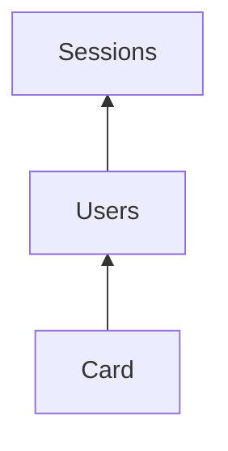

# Сортування `show_tables` за деревом залежностей

## Мета

`show_tables` друкує імена таблиць у порядку, придатному для послідовного `restore_table_structure` / `restore_table_data`: спочатку незалежні (немає outgoing relations), потім усе більш залежні.

## Модель: DAG залежностей

Побудувати орієнтований граф (дерево/ліс у ациклічному випадку; загалом DAG):

- **Ребро `A → B`**: «`A` залежить від `B`», якщо в `A.relations` є `toTableName == "B"` і `B ≠ A`.
- **Корінь / найглибший шар**: таблиці з **нульовою** кількістю залежностей (немає outgoing на інші таблиці списку) — їх треба відновлювати першими.
- **Обхід**: топологічний порядок від коренів до максимально залежних (Kahn: черга indegree 0 → знімати залежності з залежних вузлів).
- Ігнорувати `parent_relations`.
- `toTableName` на таблицю поза списком — ребро пропускати.
- За рівного indegree — стабільний порядок за іменем (`BTreeSet`), щоб вивід був детермінований.

Приклад: `Users → Sessions` → у stdout спочатку `Sessions`, потім `Users`.

## Цикли — Fail

Строгий режим для restore:

- Якщо в графі є цикл (`A↔B`, довші цикли) або **self-relation** (`A → A`) — `tables_dependency_order` повертає `Err`.
- `show_tables` пише повідомлення в stderr (імена залучених таблиць) і завершується з **non-zero**.
- Жодного partial/best-effort списку на stdout при циклі.

## Зміни в коді

Усе в [`backendless_toolkit_bin/src/db.rs`](backendless_toolkit_bin/src/db.rs) (поруч з `preflight_relations`):

1. **`fn tables_dependency_order(tables: &[TableInfo]) -> Result<Vec<String>, String>`**
   - Зібрати вузли + ребра `depender → dependee` з `relations`.
   - Self-ref → одразу `Err("dependency cycle: TableName → TableName")`.
   - Kahn; якщо після обходу лишились вузли — `Err` зі списком таблиць у циклі.
   - Успіх → `Ok(ordered_names)` від незалежних до залежних.

2. **Оновити `show_tables`**: `list_tables` → `tables_dependency_order` → друк імен; помилка сортування = fail команди.

3. **Unit-тести** у `mod tests`:
   - ланцюг `Card → Users → Sessions` → `Sessions`, `Users`, `Card`;
   - без relations — алфавіт;
   - цикл `A↔B` → `Err`;
   - self-relation → `Err`.

SDK не чіпати.

## Поза scope

- Two-phase restore для циклічних схем
- Bulk-restore команди
- Зміни SDK / `list_tables`
