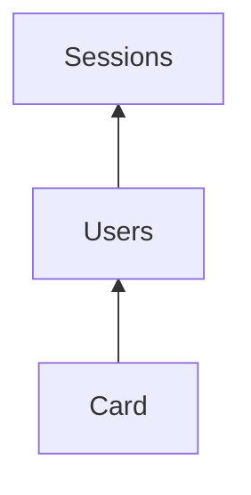

# Фільтр `show_tables` з деревом залежностей

## Поведінка

```shell
backendless-toolkit-db show_tables
# усі таблиці (як зараз)

backendless-toolkit-db show_tables PTInstallmentTemplateMapping KycUpdateStatus CmsUser
# ці три + усі транзитивні dependees з relations, у порядку restore
```

Модель ребра та сама, що в [`tables_dependency_order`](backendless_toolkit_bin/src/db.rs): `A.relations[].toTableName == B` ⇒ `A` залежить від `B` ⇒ для restore потрібен `B` раніше за `A`.

Приклад: `Card → Users → Sessions`, фільтр `Card` ⇒ stdout: `Sessions`, `Users`, `Card`.



## Правила

- Без аргументів — без змін: усі таблиці + `tables_dependency_order`.
- З аргументами — точні імена; дублікати в CLI ігнорувати.
- Невідоме ім’я → `Err` (напр. `unknown table: Foo`), non-zero exit; нічого на stdout.
- Замикання: BFS/DFS від seed-імен по **outgoing** `relations` (`toTableName`), лише вузли з `list_tables`. Ігнорувати `parent_relations` / `geo_relations` (як у сортуванні).
- Self-ref / цикл у підграфі → fail через існуючий `tables_dependency_order`.
- Після збору підмножини `TableInfo` — знову `tables_dependency_order` і друк по рядку.

## Зміни в коді

Усе в [`backendless_toolkit_bin/src/db.rs`](backendless_toolkit_bin/src/db.rs):

1. **CLI** — `show_tables` приймає `args: &[String]` (0..N імен); оновити `usage()`.
2. **`fn tables_dependency_closure(tables: &[TableInfo], seeds: &[String]) -> Result<Vec<TableInfo>, String>`**
   - перевірити, що кожен seed існує;
   - зібрати `HashSet`/`BTreeSet` імен через стек/чергу по `relations`;
   - повернути відповідні `TableInfo` (клони або фільтр slice → owned).
3. **`show_tables`** — якщо `seeds` непорожні: `closure` → `tables_dependency_order` → print; інакше як зараз.
4. **Тести** у `mod tests`:
   - замикання ланцюга `Card` → `{Sessions, Users, Card}`;
   - кілька seeds без перетину залежностей;
   - unknown seed → `Err`;
   - інтеграція з order: фільтр `Card` → `Sessions`, `Users`, `Card`.
5. **README** — один приклад з іменами таблиць у секції Database CLI.

SDK не чіпати.